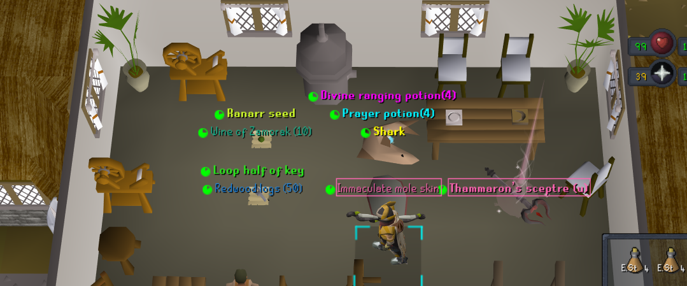

# Bem's OSRS Loot Filter

A strict, opinionated loot filter for late-mid-game and later accounts. It highlights useful supplies, progression items, notable resources, uniques, and valuable drops while hiding everything else by default.

Designed for the [Loot Filters RuneLite plugin](https://github.com/riktenx/loot-filters) and written in its `.rs2f` filter language.



## Main groups

- Clue scrolls, containers, wilderness steps, and clue-related items
- Resources: gems, ores, logs, ammunition, crafting materials, and cooking supplies
- Hunter, Herblore, and Farming supplies with quantity thresholds
- Currencies, runes, keys, bones, ashes, and other progression items
- Food, prayer restoration, and stat-boosting supplies
- Lower-priority uniques and high-priority uniques, grouped by boss or activity
- Chambers of Xeric, Theatre of Blood, and Corrupted Gauntlet overrides
- Value fallbacks at 100K, 1M, and 10M, plus a 10K high-alchemy threshold

Colors, font weights, loot beams, sounds, despawn timers, and menu priority distinguish each category. Uniques and valuable drops receive the strongest emphasis.

## Behavior

Rules are evaluated from top to bottom. Explicit global overrides and ownership rules run first, followed by category and activity rules, value-based fallbacks, and finally a catch-all rule that hides unmatched items. Changing the order can change the result.

Most thresholds, colors, item groups, and activity-specific lists are declared near the top of the filter as macros for straightforward customization.

## Installation

Install the Loot Filters plugin from the RuneLite Plugin Hub, then place `bemfilter.rs2f` in:

```text
~/.runelite/loot-filters/filters/
```

Select or reload the filter from the plugin panel.

Review the item lists and thresholds before relying on it: the filter is tailored to one account's progression and intentionally does not track every collection-log item or reward delivered directly to the inventory.
